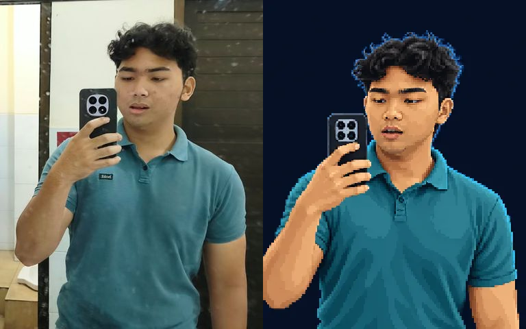
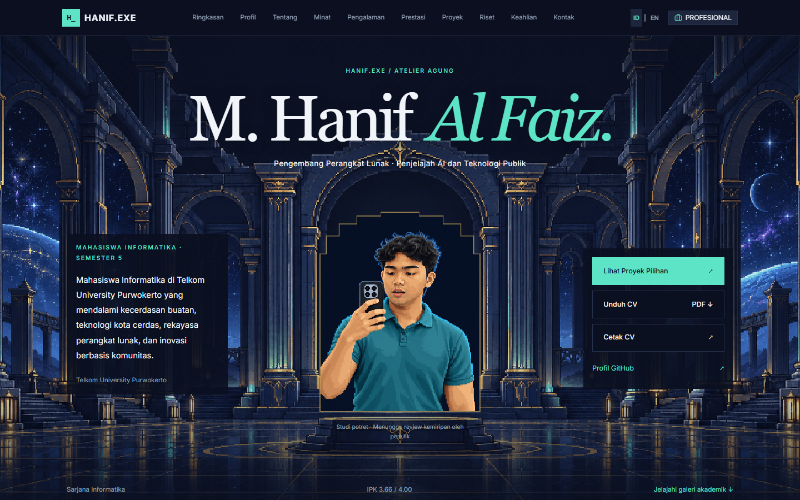
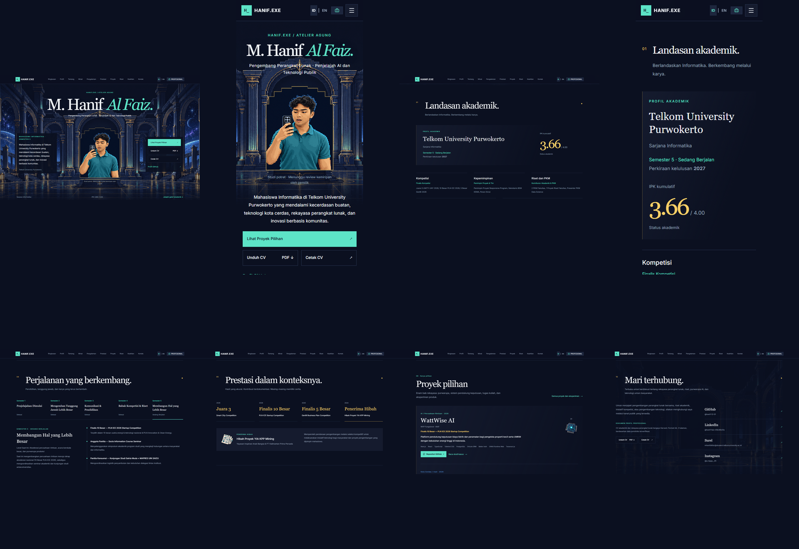

# PHASE 4D.3 COMPLETE — PIXEL GRAND ATELIER

15 October 2026 · Local production preview: http://localhost:3012 · Select Recruiter / Professional Mode. No deployment, commit or push.

## 1. Design Problem Analysis

The baseline Professional Hero used a familiar text/photo split, a full-resolution mirror selfie and small rectangular actions. Academic information was split across terminal windows, character-style labels and equally weighted boxes. It communicated information but lacked a distinct professional composition. Baseline lint and production build both passed; the dirty local Phase 4D.2 working tree was preserved rather than replaced from GitHub.

Baseline evidence: [desktop](phase-4d3/before/recruiter-1440.png), [mobile](phase-4d3/before/recruiter-390.png), baseline Git status and source hashes in phase-4d3.

## 2. New Art Direction

The Grand Atelier is a secular midnight architectural exhibition: stepped stone arches, long navy pillars, teal edge lighting, sparse gold inlay and a central portrait alcove. The Hero has a centered typographic identity above the portrait, with a concise introduction and actions in the two architectural wings. Subsequent sections use editorial pacing, varied open layouts and restrained room details. One architectural image supports the entrance and a quiet reception echo, rather than eight oversized backgrounds. Pixel Mode retains its warm woodland identity.

Design checkpoint: [GRAND_ATELIER_ART_DIRECTION.md](GRAND_ATELIER_ART_DIRECTION.md).

## 3. Original Portrait Processing

- Authenticated source: `public/profile/hanif-portrait.jpeg`, visually inspected alongside `public/Foto Profil hanif.jpeg`. Both have SHA256 `6f1955d0913e7431d27d31e42233c566e5b66e458666085ce4f08b1ae726726e` and are unchanged.
- Method: built-in image_gen identity-preserving edit, using the actual owner photograph. Retained wavy black hair, facial proportions, turned gaze, teal polo, held phone and selfie posture. Removed the bathroom/mirror background. No suit, invented credentials or substitute identity.
- Generated source: `assets-source/Grand Atelier/portrait-original.png`.
- Production candidate: `public/profile/hanif-portrait-pixel.webp`, 256×320, 48-color/no-dither nearest-neighbor preparation, lossless WebP, 45,566 bytes. This is illustrated pixel art, not the original photograph with a CSS filter.
- Likeness was visually compared with a crop of the authentic source. Facial outline, hair and clothing remain recognizable in the candidate; artistic fidelity is an owner decision. **Owner likeness approval is still required.** The preview explicitly marks the portrait study as pending review. No publication occurred.

## 4. Professional Hero Redesign

The name, role, portrait alcove, summary, CV/project/GitHub actions and academic colophon form one architectural composition. Desktop places supporting information around the central exhibit. Mobile reflows into identity → portrait → concise introduction → actions; it does not shrink the desktop arrangement. The stepped portrait framing uses a thin gold accent and a navy interior. Critical text remains HTML.

Hero desktop/mobile screenshots were captured and inspected before extending the design. Final production evidence:

[Professional mobile](phase-4d3/after/hero-recruiter-id-390.png) · [English desktop](phase-4d3/after/hero-recruiter-en-1440.png) · [English mobile](phase-4d3/after/hero-recruiter-en-390.png).

## 5. Academic Profile Redesign

One primary academic record now gives the university, degree, Semester 5 in progress, GPA 3.66/4.00 and expected graduation 2027 room to breathe. GPA is an editorial accent rather than a dashboard metric card. Supporting capabilities use three leading notes followed by two wider notes, with exact canonical descriptions. Terminal filenames, window dots, character-sheet labels, proficiency bars and hard shadows are absent from the active professional branch.

[Desktop profile](phase-4d3/after/profile-recruiter-id-1440.png) · [Mobile profile](phase-4d3/after/profile-recruiter-id-390.png).

## 6. Other Section Improvements

| Section | New professional composition |
|---|---|
| About | Biography paired with a larger pull quote from the verified biography |
| Interests | An open discipline index with one leading topic and supporting two-column entries |
| Journey | Five selectable semesters, an editorial summary and a vertical activity record; Semester 5 stays in progress |
| Achievements | Exact outcome typography, four native selectors and one selected supporting artifact; podium/finalist/grant remain distinct |
| Projects | Larger featured exhibits with small pixel domain objects, serif titles and editorial separators; supporting work remains concise |
| Research | Contribution-first records and filters, with a restrained architectural margin |
| Skills | Compact canonical category lists, with no percentages or invented expertise ratings |
| Experiments | Open archive rows, real repository actions and honest coursework-only records |
| Contact | A reception composition with preserved contact destinations and separate Harvard CV actions |

The old professional dashboard render branches were retired; the existing Pixel branch bodies were preserved byte-for-byte during that cleanup. Shared project cards remain description-first. No screenshots, fake UI previews or deployment links were introduced.

## 7. Visual Environment Assets

| Asset | Origin | Dimensions | Production bytes |
|---|---|---|---:|
| `public/profile/hanif-portrait-pixel.webp` | Owner-authorized transformation of authentic photo | 256×320 | 45,566 |
| `public/pixel/environment/grand-atelier.webp` | Original built-in image_gen architecture | 960×540 | 301,102 |

Total new production raster payload: **346,668 bytes**. Generated originals are archived under `assets-source/Grand Atelier/`. Both production files use lossless WebP with controlled palettes and nearest-neighbor preparation. Exact generation prompts and asset provenance are retained in `phase-4d3/art-prompts.json` and `assets.json`; `scripts/prepare-atelier.cjs` reproduces optimization from the archived outputs. Prior photos, sprites and raw artwork remain untouched. Repeated reception architecture uses the same cached asset.

## 8. Pixel Mode Preservation

Warm Hero woodland, workshop room, connected journey, achievement hall, props and companion remain in Pixel Mode. New atelier CSS is either scoped by recruiter mode or belongs to components rendered only in that mode. Nine retained Pixel branch hashes and cleanup checks are recorded in `pixel-branch-preservation.json`. The shared localization traversal was corrected to preserve React child identity; actual language, menu, dialogue, selection and visibility regression tests pass. The companion remains absent from Professional Mode. No canonical factual database was duplicated.

## 9. Color Palette Validation

The original UI tokens remain #0B1020, #151B2E, #1D263D, #26324D, #5DE4C7, #5AA9FF, #A78BFA, #FFD166, #F1F5F9 and #94A3B8. Navy dominates, teal carries actions and technical identity, and gold is limited to architectural inlay, honors and small academic accents. Blue/purple remain secondary environmental light. No white/beige corporate palette or universal gold card borders were added.

## 10. Typography Review

Georgia/Times fallback provides editorial display typography; the existing Inter/system sans-serif carries navigation and body copy. The existing pixel font remains available for Pixel Mode. No font dependency, network font family or package was added. English and Indonesian Latin glyphs were rendered in browser checks. Main body copy remains roughly 14–16px; smaller metadata is secondary. Name and heading sizes reflow on narrow screens rather than forcing horizontal scrolling.

## 11. Bilingual Regression

All four combinations pass: Pixel EN, Pixel ID, Professional EN and Professional ID. The centralized catalogue now contains 911 merged source keys, including new headings, portrait alt text, actions and accessible filter names. The source audit reports zero missing canonical descriptive translations; unchanged runtime copy was reviewed as proper names, technologies, identifiers or terms shared by both languages.

Language and mode remain independent and persisted. Current URL/project slug/hash and scroll are preserved. Additional checks confirm that changing locale retains the selected semester, honor and research filter. All six case studies were tested in both languages and both modes. Routes were not migrated.

## 12. Harvard CV Validation

Both PDFs, print HTML pages, generator, shared CV template and CV localization source remain byte-identical to this phase's baseline. They were not redesigned or regenerated.

| CV | Pages | Extracted characters/page | Independent rendered ink/page |
|---|---:|---|---|
| English | 2 | 4,402 / 1,673 | 9.283% / 3.982% |
| Indonesian | 2 | 4,458 / 1,594 | 9.801% / 3.945% |

`node scripts/audit-cv.js` passes strict parsing, substantial text on every page, verified factual headings/outcomes, 30 curated skills and independent Poppler rendering. Existing browser validation was rerun: Chromium 151.0.7922.34, Chrome 155.0.8059.79 and Edge 155.0.4283.45 each pass EN/ID download filename/hash, native beforeprint with loaded fonts, and CDP print-engine PDF extraction/render checks. Standalone print pages contain 6,137 / 6,115 visible characters. Chrome/Edge PDF viewer checks pass; the bundled headless Chromium native viewer downloads PDF navigation instead, recorded separately. Physical printer/manual Windows print dialog: **NOT TESTED**.

The actual website's Hero, Contact and Footer CV targets and downloads pass in all four language/mode combinations. See retained `docs/cv-validation/browser/browser-results.json` for the six actual browser cases.

## 13. Browser Issue Investigation

The reported “18 Issues” was investigated without assuming 18 independent bugs. The reproduced baseline Dev Tools menu showed **16 issues**, and the issue panel was opened and captured. All 16 captured console messages were the React unique-key warning across Navbar, Link, PetControls, Hero, PlayerProfile, About, Journey and Footer. One shared cause was the localization helper's plain Array.map plus element cloning: static sibling key validation was lost. Dynamic navigation records already had explicit keys.

The helper now uses React.Children.map, which provides stable traversal identity while retaining explicit record keys. The development indicator was not disabled or hidden. A fresh four-mode/language development walk reports **0 console errors, 0 warnings and 0 runtime exceptions**, and Dev Tools no longer lists an Issues entry. Eight independent fresh viewport sessions also report no warning/error. Evidence: `before/issues-panel-open.png`, `before/issue-panel-details.json`, `dev-diagnostics.json`, `dev-responsive-diagnostics.json` and `after/dev-panel-final.png`.

Two image-dimension advisories and one transient dev JSON parse/500 were observed in intermediate hot-reload logs during edits. Neither reproduced on stable final requests, the fresh viewport sessions, production navigation or final build. Their exact relationship to the owner's earlier count of 18 cannot be established. They are not silently counted as additional fixed application defects. No reproducible current hydration, image-loading or runtime failure remains in the tested flows.

## 14. Responsive Test Results

1440, 1280, 1024, 768, 430, 390, 375 and 320px × two languages × two modes = **32 production layouts PASS**. Desktop test height is 900px, mobile 844px. Full lazy content was traversed before geometry/image checks. No horizontal overflow, off-screen controls or broken images were detected.

An additional **16 Professional EN/ID composition checks** at all eight widths confirm no portrait intersection with name, introduction or action groups. Every Hero link has an unobscured pointer hit target. Screenshots capture both languages, both modes, desktop/mobile and every primary section. Production regression: **41/41 checks PASS**.

## 15. Accessibility Results

Keyboard skip link, menu Escape/focus restoration, native semester/honor controls, research selected states, language active state, localized portrait descriptions and document language pass. Professional Hero has one h1 and its sections use semantic h2/h3/h4 hierarchy. Language changes preserve selection state and keyboard Space activates the switcher. Reduced motion produces no running Hero animation and stops existing Pixel scenery motion.

The token contrast calculation covers all six foreground colors against the three solid navy surfaces: **5.52:1–17.28:1**. Hero supporting copy/actions use dark reading surfaces, with visual review over the architecture. This is not a claim of complete automated per-pixel contrast certification. Human screen-reader speech output and physical phone testing: **NOT TESTED**. No new interactive control is intentionally hidden by scenery.

## 16. Performance Measurements

Actual single-sample observations from cold browser contexts on local production Chromium 151.0.7922.34, unthrottled network/CPU. These are laboratory snapshots, not field Core Web Vitals or evidence of a speed improvement.

| Mode | Width | Language | Observed LCP | Observed CLS |
|---|---:|---|---:|---:|
| Pixel | 1440 | EN | 332 ms | 0.00360 |
| Pixel | 1440 | ID | 328 ms | 0.00492 |
| Pixel | 390 | EN | 232 ms | 0.01915 |
| Pixel | 390 | ID | 248 ms | 0.03922 |
| Professional | 1440 | EN | 472 ms | 0.00395 |
| Professional | 1440 | ID | 460 ms | 0.00337 |
| Professional | 390 | EN | 448 ms | 0.00000 |
| Professional | 390 | ID | 524 ms | 0.00000 |

Raw resource timings are in `phase-4d3/browser-results.json`. New art payload is 346,668 bytes; no large uncompressed production background or additional downloaded font family was added. Below-fold supporting raster objects use lazy loading. Retired dashboard branches avoid shipping the replaced render paths. Lighthouse scores, throttled device performance and field INP: **NOT TESTED**, deferred to the separately approved release QA phase.

## 17. Files Modified

Exact existing files changed during Phase 4D.3, relative to its local hash baseline:

- `src/app/globals.css` — import the mode-scoped atelier stylesheet.
- `src/components/layout/Footer.tsx` — replace the professional terminal record label.
- `src/components/pixel/PixelSectionTitle.tsx` — professional archive heading without terminal decoration.
- `src/components/sections/Hero.tsx` — dispatch to the new professional Hero; keep Pixel Hero.
- `src/components/sections/PlayerProfile.tsx` — dispatch to academic gallery; retire professional dashboard branch.
- `src/components/sections/About.tsx` — dispatch to editorial biography.
- `src/components/sections/Interests.tsx` — dispatch to discipline index.
- `src/components/sections/Journey.tsx` — dispatch to professional timeline.
- `src/components/sections/TrophyRoom.tsx` — dispatch to honors gallery.
- `src/components/sections/ProjectLab.tsx` — align the professional exhibit number with the curated room sequence.
- `src/components/sections/ResearchCompetitions.tsx` — dispatch to contribution records.
- `src/components/sections/SkillsInventory.tsx` — dispatch to compact expertise categories.
- `src/components/sections/GithubExperiments.tsx` — dispatch to technical archive.
- `src/components/sections/LetsBeFriends.tsx` — dispatch to reception/contact composition.
- `src/i18n/id.ts` — merge new presentation copy.
- `src/i18n/root-id.ts` — portrait, Hero and action translations.
- `src/i18n/useTranslations.tsx` — correct shared child traversal/key warnings.
- `src/lib/mediaConfig.ts` — clarify that an owner-authorized source-photo transformation is distinct from an invented identity.
- `scripts/audit-i18n.cjs` — allow an explicit evidence output path without overwriting earlier phase evidence.
- `.gitignore` — retain the explicitly required Phase 4D.3 reports and evidence.

Protected canonical data, Harvard CV code/artifacts and source photographs did not change. The overall Git diff also contains the owner's earlier uncommitted phases; those are not all Phase 4D.3 changes.

## 18. Files Created

- `src/components/atelier/AtelierHero.tsx`
- `src/components/atelier/AtelierSections.tsx`
- `src/styles/atelier.css`
- `src/i18n/atelier-id.ts`
- `public/profile/hanif-portrait-pixel.webp`
- `public/pixel/environment/grand-atelier.webp`
- `assets-source/Grand Atelier/portrait-original.png`
- `assets-source/Grand Atelier/grand-gallery-original.png`
- `scripts/prepare-atelier.cjs`
- `scripts/qa-grand-atelier.cjs`
- `scripts/qa-atelier-composition.cjs`
- `docs/GRAND_ATELIER_ART_DIRECTION.md`
- `docs/GRAND_ATELIER_REPORT.md`
- Evidence files under `docs/phase-4d3/`, enumerated in `phase-4d3/file-manifest.json`.

## 19. Git State

The project began with substantial uncommitted Phase 4D.1/4D.2 work. No reset, checkout replacement, commit, push, PR or deployment was performed. Baseline status/hashes and final status/diff-stat evidence are retained. `git diff --check` passes; Windows LF/CRLF conversion notices are informational.

Final commands executed: `npm run lint` PASS; `npx tsc --noEmit` PASS; `npm run build` PASS (Next 16.3.8 Turbopack, 13 generated entries); `node scripts/audit-cv.js` PASS; existing three-browser localized print/download validation PASS; `node scripts/qa-grand-atelier.cjs` PASS; `node scripts/qa-atelier-composition.cjs` PASS; source translation audit PASS. No dependency versions changed.

## 20. Remaining Issues

- Visual: final artistic judgment belongs to the owner; the portrait is a candidate study, not an approved likeness.
- Functional: no reproducible current blocker found in tested routes/interactions. A pre-existing free-following Pixel companion can occupy a lower reading corner and remains hideable; Professional Mode has no companion overlay.
- Accessibility: automated behavior/token checks passed; human screen-reader speech and real phone checks were not performed.
- Owner review: confirm face/hair likeness, clothing/pose treatment, desktop/mobile composition, Indonesian wording and professional typography. Review preserved contact destinations, both CVs and final domain before any future deployment.
- Performance/release: Lighthouse, final production SEO/domain configuration and physical printer checks remain untested here. No scores or manual approvals are fabricated.

## 21. Visual Approval Recommendation

**READY FOR OWNER VISUAL REVIEW**

The professional composition, pixel portrait candidate, editorial rooms, bilingual behavior and production checks are implemented. The tested build has no observed blocking console/runtime or layout failure. This recommendation is not final design or likeness approval.

## 22. Next Step

Await the owner's evaluation of the updated design and portrait. After visual approval, proceed to final SEO, Lighthouse and release QA under a separate instruction. **Do not deploy automatically. Stop here for owner review.**
