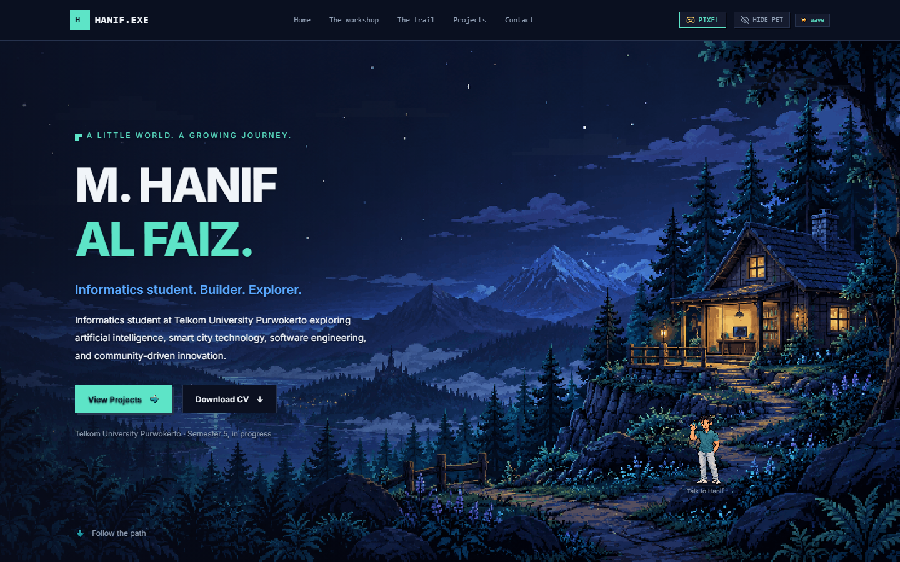
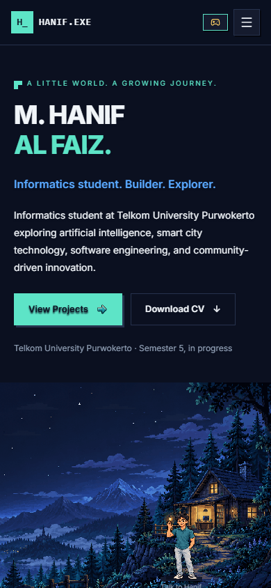
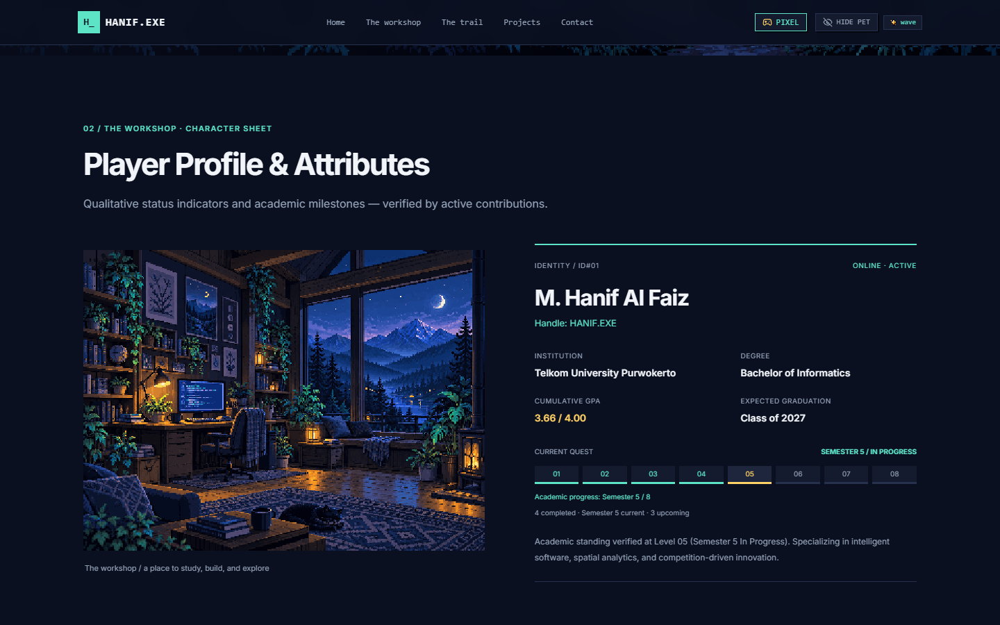
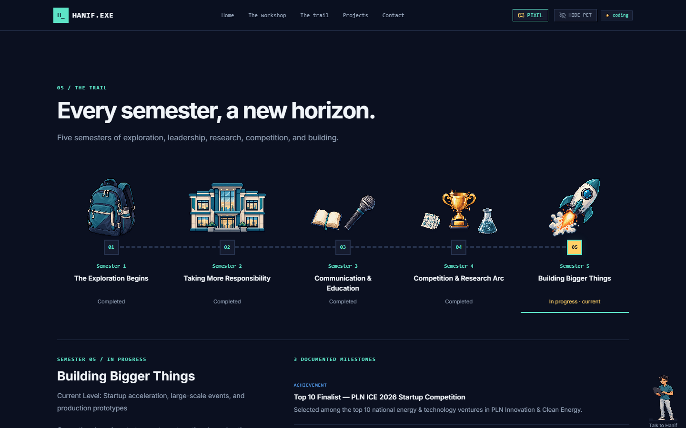
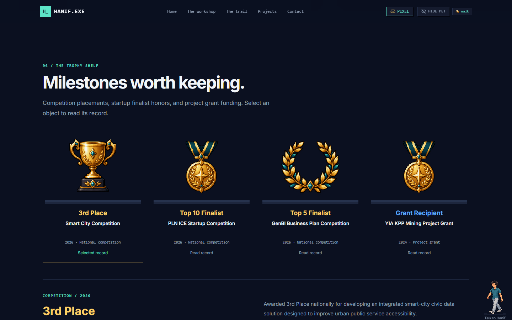
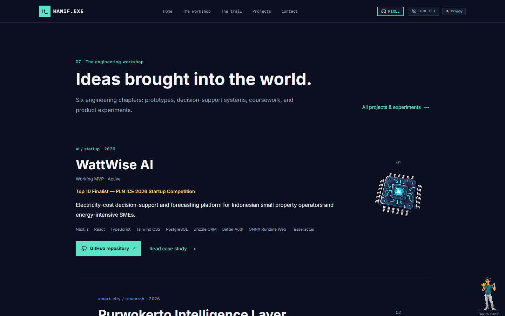
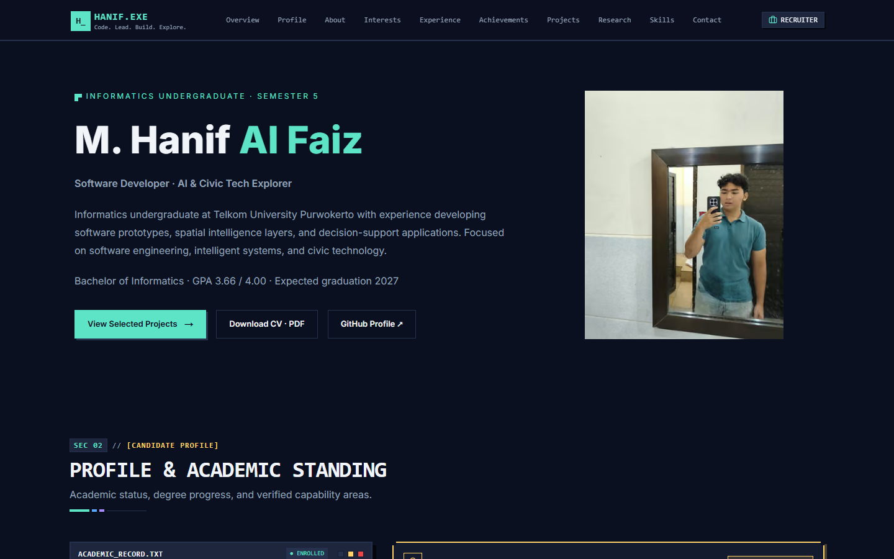
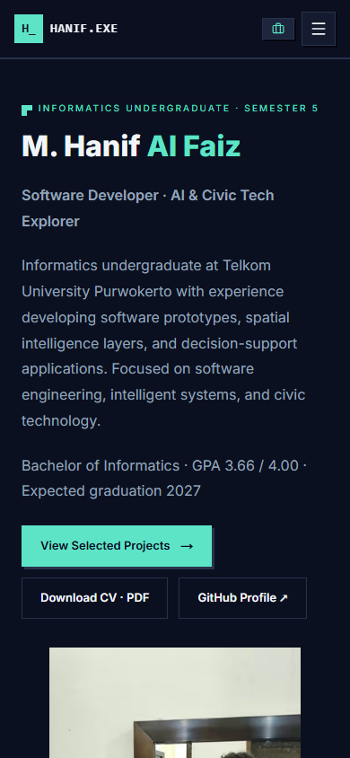

# HANIF.EXE — LIVING PIXEL WORLD REDESIGN REPORT

Phase 4D.1 · 14 October 2026 · Local workspace: D:\\LOMBA\\Portofolio

**Recommendation: READY FOR OWNER VISUAL REVIEW.** Implementation and technical QA are complete.
This is not visual approval on the owner's behalf. No commit, push, deployment, or Phase 4E work occurred.

## 1. Baseline Design Problems

The prior hero used a conventional split grid, large framed photograph, dotted background,
terminal metadata and equally weighted badges. Profile information lived in a character-sheet
window and repeated capability cards. Projects occupied schematic preview windows. The
floating character had a large independent border, weakening the sense of place.

Baseline evidence: [desktop hero](visual-review/baseline/hero-desktop.png),
[mobile hero](visual-review/baseline/hero-mobile.png), [profile](visual-review/baseline/profile-desktop.png).
The initial Turbopack dev CSS child-process failure was bypassed with Webpack for baseline
capture; the final ordinary Turbopack production build passes.

## 2. New Visual Direction

A midnight woodland, mountain valley and illuminated engineering cabin now anchor the
portfolio. A workspace interior continues the same view. Open narratives, an academic dossier,
a semester trail, trophy shelves, engineering chapters, field notes and a closing clearing
replace repeated terminal-card compositions. Ordinary scrolling and navigation remain intact.

The coherent implementation plan is [LIVING_PIXEL_WORLD_ART_DIRECTION.md](LIVING_PIXEL_WORLD_ART_DIRECTION.md).

## 3. Reference Analysis

Large connected silhouettes and far-to-near layers follow the methodology of
[Saint11 cluster sketching](https://saint11.art/pixel_art_articles/article2/).
Cool shadows, limited saturation and small warm focal lights apply principles from
[Saint11 color theory](https://saint11.art/pixel_art_articles/article6/).
[Aseprite](https://www.aseprite.org/api/command/SpriteSize) informed nearest-neighbor scaling;
[Lospec](https://lospec.com/pixel-art-tutorials/) informed pixel landscape craft.
[Ali Taee](https://www.alitaee.dev/) and [Pablo's Room](https://pablo.fail/how-i-built-pablos-room)
informed a portfolio experienced as a place. These are interpretations of methodology,
not copies of source artwork or interaction code. Owner reference images were unavailable
locally; their supplied textual descriptions were used.

## 4. Color Palette

The authoritative UI tokens remain exact: #0B1020, #151B2E, #1D263D, #26324D,
#5DE4C7, #5AA9FF, #A78BFA, #FFD166, #F1F5F9 and #94A3B8. Recruiter Mode now
also uses these locked values rather than its previous separate overrides. Scene-derived
navy, blue, teal and purple shades support atmospheric depth; golden light is restrained.

## 5. New Environment Assets

| Asset | Origin | Dimensions | Bytes | Role |
| --- | --- | --- | --- | --- |
| woodland-workshop.webp | Original built-in image_gen scene, 64-color logical export | 768 × 432 | 182,736 | Hero sky, mountains, woodland, cabin, path and foreground |
| workshop-interior.webp | Original built-in image_gen scene, 64-color logical export | 384 × 288 | 72,902 | Profile workspace, research props and window into same world |
| clouds.svg | Original integer-grid SVG | 768 × 160 | 419 | Restrained transform-only cloud layer |
| foreground.svg | Original integer-grid SVG | 768 × 96 | 593 | Secondary trail/clearing transition silhouette |

Generated originals remain separately archived at 1672 × 941 and 1448 × 1086. Existing
raw archives were not overwritten. Full dimensions, provenance and weights for every
new export are in [LIVING_PIXEL_WORLD_ASSET_AUDIT.md](LIVING_PIXEL_WORLD_ASSET_AUDIT.md)
and [asset-inventory.json](visual-review/asset-inventory.json). Exact built-in generation
prompts are in [generation-prompts.json](visual-review/generation-prompts.json).

## 6. Pixel-Art Conversion Audit

Existing authorized pixel props now have 32 / 192 / 384px logical, 64-color, no-dither,
lossless WebP exports. Nine existing character poses retain alpha, are tightly cropped,
and share a 144px logical height. Sample city, book, trophy, character and scene silhouettes
were visually inspected, then assessed at actual browser display sizes.

The authentic portrait files are byte-identical. A separate crop at x530/y500, 650 × 1000
was reduced to 104 × 160, 24 colors without dithering, and enlarged 3× with nearest-neighbor.
The study preserves identity but retains photographic clutter and softened facial detail.
It is **withheld from the production UI** and remains a review artifact:
[portrait study](visual-review/portrait-study/hanif-portrait-pixel-review.png).
A finished portrait conversion needs artistic refinement and owner review.

Recruiter Mode keeps the original authentic photo. Pixel Mode uses the approved companion
and scene artwork, with no raster photograph. Small smooth menu, mode, visibility and social
marks remain where they assist recognition and usability. Prominent decoration uses pixel
props; normal text, source evidence and the CV remain readable HTML/PDF.
The full family-by-family classification and source paths are in the asset audit.

## 7. Hero Redesign

The hero is a full environmental stage: quiet dark sky behind the name; layered mountain
and woodland midground; warm workshop; winding path and dark foliage. A subtle readability
overlay has no terminal frame. Projects and CV are directly accessible. Mobile places
readable copy above a deliberate cabin crop instead of shrinking the desktop composition.

## 8. Pixel Hanif Integration

One existing companion instance docks on the hero path through a portal. It returns to its
compact floating position when less than a quarter of the hero remains visible. The frame
is replaced by transparent art and a small ground shadow. The existing context remains the
single source of truth for poses, click count, dialogue, dismissal and persisted visibility.
Click, Enter, Escape, visibility persistence, dock/follow behavior, and Recruiter hiding
passed real browser checks. Reduced motion freezes ambient scenery.

## 9. Profile / About / Interests

Profile pairs the original workshop interior with one academic dossier and open capability
evidence rows. Name, university, degree, GPA, semester, expected graduation, ranks, highlights
and tags remain. About retains all canonical biography paragraphs, principles and current
focus notes in an open reading layout with book/research props. Interests gives the city
landmark room to breathe, followed by varied domain groups and all topic labels.

Additional evidence: [About](visual-review/redesign/about-desktop.png),
[Interests](visual-review/redesign/interests-desktop.png).

## 10. Journey & Trophy Room

Five native semester buttons connect along a desktop trail and stack into a vertical mobile
path. Selected panels retain the full chronological milestones. Semester 5 is visibly
in progress; future semesters in the academic progress display remain upcoming. All five
buttons passed Enter activation and aria-current/aria-pressed selection checks.

Four open shelf displays preserve **3rd Place, Top 10 Finalist, Top 5 Finalist, and Grant
Recipient** distinctions. Trophy selection retains aria-pressed, controlled live evidence,
and exact outcomes. No award is relabeled as first place.

## 11. Projects Redesign

Homepage, directory and all six case studies have no screenshot slots, empty media frames,
architecture schematic previews or pending-capture banners. Small domain props are clearly
illustrative. Titles, descriptions, full technology labels, maturity, status, achievements,
case-study routes, source-code evidence and genuine repositories remain.

| Project | Repository | Route status |
| --- | --- | --- |
| WattWise AI | [start-up-repo](https://github.com/hanif-12-01/start-up-repo) | /projects/wattwise-ai — 200 |
| Purwokerto Intelligence Layer | [Purwokerto-intelligence-layer](https://github.com/hanif-12-01/Purwokerto-intelligence-layer) | /projects/purwokerto-intelligence-layer — 200 |
| SIMOBS | [bengkel](https://github.com/hanif-12-01/bengkel) | /projects/simobs-bengkel — 200 |
| Lapor Mangan | [LAPORMANGAN](https://github.com/hanif-12-01/LAPORMANGAN) | /projects/lapor-mangan — 200 |
| Bernas MBG | [Bernas-MBG](https://github.com/hanif-12-01/Bernas-MBG) | /projects/bernas-mbg — 200 |
| Fuzzy Rain Risk Index | [Tubes-Dasar-Kecerdasan-Artificial](https://github.com/hanif-12-01/Tubes-Dasar-Kecerdasan-Artificial) | /projects/ai-course-project — 200 |

All six repositories responded to git ls-remote HEAD. Exact results are saved in
[repository-validation.json](visual-review/repository-validation.json).
The unused preview source remains reusable; no public component imports it.
Placeholder, media-integration and owner-checklist documentation now explicitly states that
screenshots are optional and are not required before launch.

[Mobile project chapter](visual-review/redesign/projects-mobile.png).

## 12. Recruiter Mode Protection

Recruiter Mode retains professional content, verified owner photo, clean navigation,
CV download, repository links, readable projects and the existing professional section
variants. It uses the same data and persisted mode. Environmental layers and companion UI
are hidden. Navigation from case-study routes now targets the matching homepage section.

## 13. Responsive Validation

Both modes were tested at **1440, 1280, 1024, 768, 430, 390, 375 and 320px**: 16 combinations.
Every combination had document scroll width equal to viewport width, zero clipped links,
buttons or summaries, zero broken images, and no mobile hero text/art overlap. Mobile menu Escape dismissal and focus return
passed. These are Chromium viewport checks, not physical-device or cross-browser testing.

## 14. Accessibility

Skip navigation focuses main content. Headings, native buttons/links, selected milestone
semantics, trophy pressed states, research filters/live announcements and keyboard dialogue
controls remain. Decorative art uses empty alt / aria-hidden; meaningful owner photography
has descriptive alt. Visible focus is present. Reduced-motion cloud animation is none and
scroll behavior is auto. With pixel/pet image requests intentionally blocked, the name,
academic facts, all six repositories and CV remain available.

Token contrast on #0B1020: text **17.28:1**, muted **7.38:1**, teal **12.07:1**, blue **7.71:1**,
purple **6.96:1**, gold **13.13:1**. These are computed token-pair ratios, not an exhaustive
WCAG certification or a measurement of every pixel in raster backgrounds. Text over the
hero was visually reviewed with its dark text-safe overlay.

Evidence: [contrast-check.json](visual-review/contrast-check.json),
[image-failure-check.json](visual-review/image-failure-check.json).

## 15. Performance

All new production image/layer exports total **636,108 bytes**: environments 256,650;
nine companion states 49,968; reused prop exports 329,490. The source prop PNGs total
14,125,615 bytes and are preserved. The city export is 42,436 bytes versus its original
1,436,704 bytes. Only essential hero art is preloaded; below-fold artwork is lazy.
No game engine, rendering loop, expensive layout animation or scroll hijacking was added.

The final local production warm-cache navigation measured **89.9ms** total and
**28.3ms** to DOMContentLoaded; the cached hero resource measured **2.9ms**
and a 300-byte conditional response. These local cached observations are not cold-network
benchmarks. No Core Web Vitals improvement is claimed, and Lighthouse / Phase 4E was not run.
Full resource observations are in [browser-results.json](visual-review/browser-results.json).
Production static generation is preserved: 13 generated pages, including six case studies.

## 16. Files Added / Modified

Exact workspace-relative paths follow. Absolute root is D:\\LOMBA\\Portofolio.
The machine-readable copy is [modified-files.json](visual-review/modified-files.json).
next-env.d.ts changed only through Next's build generation from dev type references to
production type references. The .gitignore exceptions make the explicitly requested
review documents and screenshots retainable; no commit or staging occurred.

- `.gitignore`
- `assets-source/Living Pixel World/woodland-workshop-original.png`
- `assets-source/Living Pixel World/workshop-interior-original.png`
- `docs/LIVING_PIXEL_WORLD_ART_DIRECTION.md`
- `docs/LIVING_PIXEL_WORLD_ASSET_AUDIT.md`
- `docs/LIVING_PIXEL_WORLD_REDESIGN_REPORT.md`
- `docs/MEDIA_INTEGRATION_GUIDE.md`
- `docs/PLACEHOLDER_REGISTER.md`
- `docs/PRE_DEPLOYMENT_OWNER_CHECKLIST.md`
- `docs/visual-review/asset-inventory.json`
- `docs/visual-review/baseline/hero-desktop.png`
- `docs/visual-review/baseline/hero-mobile.png`
- `docs/visual-review/baseline/profile-desktop.png`
- `docs/visual-review/browser-results.json`
- `docs/visual-review/contrast-check.json`
- `docs/visual-review/generation-prompts.json`
- `docs/visual-review/image-failure-check.json`
- `docs/visual-review/locked-hashes-before.json`
- `docs/visual-review/modified-files.json`
- `docs/visual-review/portrait-study/hanif-portrait-pixel-review.png`
- `docs/visual-review/redesign/about-desktop.png`
- `docs/visual-review/redesign/hero-pixel-1440.png`
- `docs/visual-review/redesign/hero-pixel-390.png`
- `docs/visual-review/redesign/hero-recruiter-1440.png`
- `docs/visual-review/redesign/hero-recruiter-390.png`
- `docs/visual-review/redesign/hero-reduced-motion.png`
- `docs/visual-review/redesign/interests-desktop.png`
- `docs/visual-review/redesign/journey-desktop.png`
- `docs/visual-review/redesign/profile-desktop.png`
- `docs/visual-review/redesign/projects-desktop.png`
- `docs/visual-review/redesign/projects-mobile.png`
- `docs/visual-review/redesign/research-desktop.png`
- `docs/visual-review/redesign/skills-desktop.png`
- `docs/visual-review/redesign/trophies-desktop.png`
- `docs/visual-review/repository-validation.json`
- `next-env.d.ts`
- `public/pet/optimized/coding.webp`
- `public/pet/optimized/idle.webp`
- `public/pet/optimized/microphone.webp`
- `public/pet/optimized/reading.webp`
- `public/pet/optimized/rocket.webp`
- `public/pet/optimized/sleep.webp`
- `public/pet/optimized/trophy.webp`
- `public/pet/optimized/walk.webp`
- `public/pet/optimized/wave.webp`
- `public/pixel/achievements/achievement-confetti.webp`
- `public/pixel/achievements/achievement-laurel.webp`
- `public/pixel/achievements/achievement-medal.webp`
- `public/pixel/achievements/achievement-sheet.webp`
- `public/pixel/achievements/achievement-sparkle.webp`
- `public/pixel/achievements/achievement-trophy.webp`
- `public/pixel/environment/clouds.svg`
- `public/pixel/environment/foreground.svg`
- `public/pixel/environment/woodland-workshop.webp`
- `public/pixel/environment/workshop-interior.webp`
- `public/pixel/journey/semester-1-backpack.webp`
- `public/pixel/journey/semester-2-organization-building.webp`
- `public/pixel/journey/semester-3-book.webp`
- `public/pixel/journey/semester-3-microphone.webp`
- `public/pixel/journey/semester-4-research-document.webp`
- `public/pixel/journey/semester-4-research-flask.webp`
- `public/pixel/journey/semester-4-trophy.webp`
- `public/pixel/journey/semester-5-rocket.webp`
- `public/pixel/tech/tech-ai-chip.webp`
- `public/pixel/tech/tech-code-editor.webp`
- `public/pixel/tech/tech-database.webp`
- `public/pixel/tech/tech-gis-map.webp`
- `public/pixel/tech/tech-server.webp`
- `public/pixel/tech/tech-smart-city.webp`
- `public/pixel/ui/ui-arrow-down.webp`
- `public/pixel/ui/ui-arrow-left.webp`
- `public/pixel/ui/ui-arrow-right.webp`
- `public/pixel/ui/ui-check.webp`
- `public/pixel/ui/ui-checkpoint.webp`
- `public/pixel/ui/ui-code.webp`
- `public/pixel/ui/ui-external-link.webp`
- `public/pixel/ui/ui-folder.webp`
- `public/pixel/ui/ui-map-pin.webp`
- `public/pixel/ui/ui-sparkle.webp`
- `public/pixel/ui/ui-star.webp`
- `scripts/prepare-living-world.cjs`
- `scripts/qa-living-world.cjs`
- `src/app/globals.css`
- `src/app/projects/page.tsx`
- `src/components/layout/Footer.tsx`
- `src/components/layout/Navbar.tsx`
- `src/components/pet/PetControls.tsx`
- `src/components/pet/PixelHanifPet.tsx`
- `src/components/projects/FeaturedProjectCard.tsx`
- `src/components/projects/ProjectCard.tsx`
- `src/components/projects/ProjectCaseStudy.tsx`
- `src/components/projects/ProjectPreviewViewport.tsx`
- `src/components/sections/About.tsx`
- `src/components/sections/GithubExperiments.tsx`
- `src/components/sections/Hero.tsx`
- `src/components/sections/Interests.tsx`
- `src/components/sections/Journey.tsx`
- `src/components/sections/LetsBeFriends.tsx`
- `src/components/sections/PlayerProfile.tsx`
- `src/components/sections/ProjectLab.tsx`
- `src/components/sections/ResearchCompetitions.tsx`
- `src/components/sections/SkillsInventory.tsx`
- `src/components/sections/TrophyRoom.tsx`
- `src/components/world/WorldScene.tsx`
- `src/data/worldAssets.ts`
- `src/lib/mediaConfig.ts`
- `src/styles/world-chapters.css`
- `src/styles/world-identity.css`
- `src/styles/world-projects.css`
- `src/styles/world.css`

## 17. Locked Content Protection

SHA-256 checks confirm every listed canonical data file, CONTENT_INTEGRITY.md, both CV
scripts, CV PDF and both original photographs are byte-identical to the clean baseline.
Social destinations remain authoritative and unchanged. Original World Assets, Raw character
and Environment archive paths have no Git diff. The only asset data update is worldAssets.ts
production image paths and archive-source comments.
[Locked hashes](visual-review/locked-hashes-before.json) and browser results contain evidence.

## 18. Test Results

| Check | Final result |
| --- | --- |
| npm run lint | PASS |
| npm run build | PASS — ordinary Turbopack production build, 13 pages |
| npx tsc --noEmit | PASS |
| node scripts/audit-cv.js | PASS — 0 violations, 30 valid skills, unchanged 243,413-byte two-page PDF |
| git diff --check | PASS |
| git status --short | Inspected; changes remain unstaged/uncommitted |
| Real Chromium checks | **21 / 21 PASS** |
| Mode × viewport matrix | **16 / 16 PASS** |
| Six repositories | All HEADs resolved |
| Six case studies / directory / journey | All 200 |
| /dev, /pet-test, /asset-test | All 404; no accidental development pages in build |
| Console errors / warnings / failed app responses | 0 / 0 / 0 |
| Image-failure content check | PASS |
| Canonical and CV hashes / original archives | PASS |

Reproduce browser review with `rtk proxy node scripts/qa-living-world.cjs http://localhost:3012`
against the local production server. The script finds the installed or cached Playwright
runtime without changing project dependencies. Build/lint/TypeScript/CV were checked after
implementation fixes. Earlier failed harness targeting and local preview binding attempts
were corrected; final results above describe the completed implementation.

## 19. Visual Acceptance Scores

These are qualitative design-review scores based on inspected artwork and actual screenshots,
not automated measurements and not owner approval.

| Category | Score / 5 | Reason |
| --- | --- | --- |
| Environmental art quality | 4 | Detailed original woodland/workshop scenes, clear clustered silhouettes; generated craft can still benefit from artist refinement. |
| Depth and atmosphere | 5 | Distinct mountain, woodland, cabin, path and foreground planes with restrained warm light. |
| Organic composition | 4 | Hero and workspace lead; open chapters replace terminal boxes; some evidence rows remain deliberately regular. |
| Pixel-art consistency | 4 | Logical canvases, nearest rendering and consistent exports; existing props have varied source texture, semantic controls remain smooth. |
| Brand palette consistency | 5 | Exact UI tokens retained; blue-hour art belongs to the established brand. |
| Visual storytelling | 4 | Cabin, reading props, five landmarks, trophies and engineering chapters connect the narrative. |
| Character integration | 4 | Single transparent companion with path docking and ground shadow; mobile character scale is intentionally generous for tapping. |
| Section variety | 4 | Workshop, narrative, city landmark, trail, shelf, editorial projects and open notes; later text-heavy sections use simpler scenery. |
| Text readability | 5 | Safe navy zones, readable flow, tested token contrast, and clean mobile layouts. |
| Recruiter Mode preservation | 4 | Professional hero/projects and existing clean factual presentation retained; prior section framing remains in the protected alternative. |

## 20. Remaining Issues

**Visual concerns:** A finished faithful pixel portrait is deferred; the automatic study
is withheld. Original generated art and the mix of reused prop styles still need the owner's
visual judgment. Smaller later chapters are intentionally quieter than the signature hero.

**Technical limits:** No known failing check. Browser coverage is Chromium only. Local
warm-cache timings are not field performance or physical-device validation. Turbopack dev
had a baseline-only CSS process failure; production Turbopack is successful, Webpack dev works.

**Owner decisions:** Review desktop/mobile screenshots and the live local preview. Decide
whether the new world meets the intended atmosphere and whether a manually refined portrait
is wanted later. Existing production-domain choice and deployment approval remain later gates.

## 21. Approval Recommendation

**READY FOR OWNER VISUAL REVIEW**

The environmental hero, chapter compositions, character integration, screenshot-free projects,
asset provenance, preservation locks, responsive checks and technical validation are ready to
review. Final visual approval belongs to the owner.

## 22. Next Step

Await owner screenshot review and approval. Only after visual approval should work continue
to **PHASE 4E — SEO, LIGHTHOUSE & FINAL RELEASE QA**. No deployment or automatic continuation
has occurred. The local production preview is available at http://localhost:3012.

